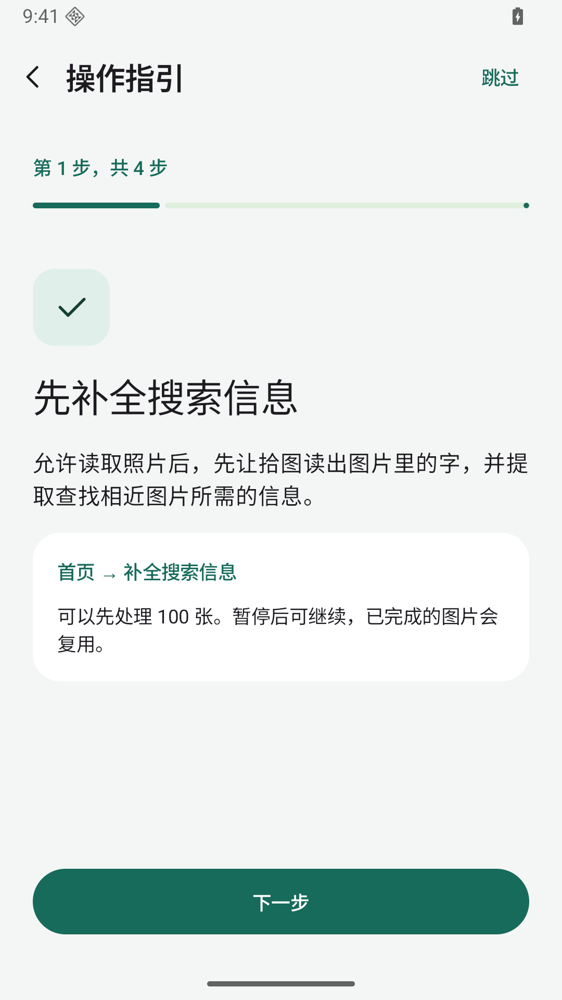
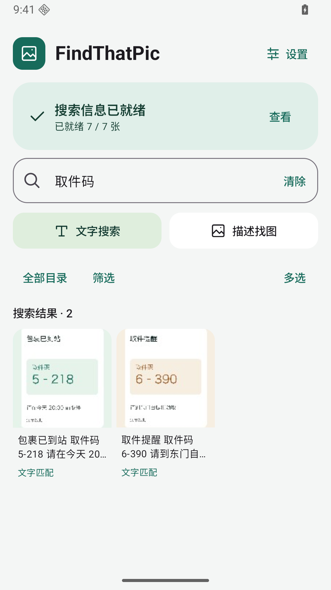
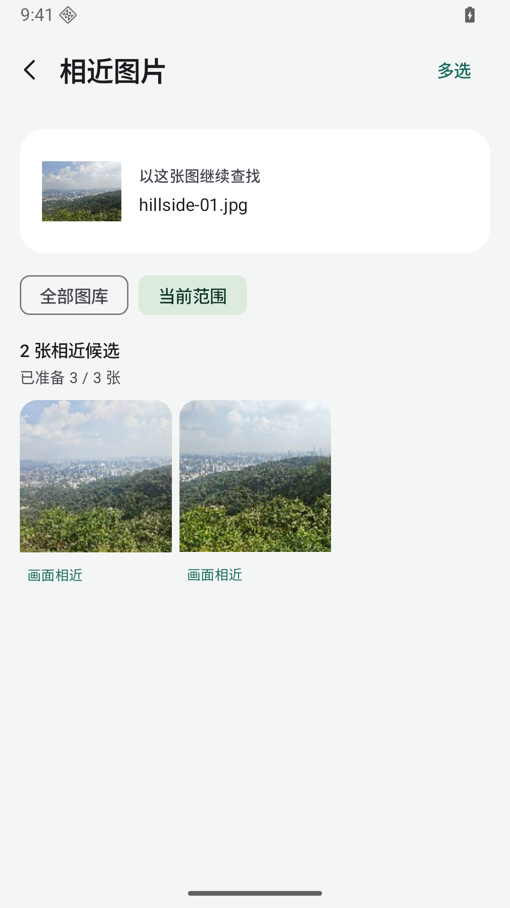

# 拾图 · FindThatPic

记得截图里有「取件码」，却忘了存在哪？打开拾图，搜你还记得的几个字。也可以拿一张照片找相近图片，或在普通版里直接描述你想找的画面。

[下载 APK](https://github.com/zurrll/FindThatPic/releases) · Android 10+ · ARM64

<p>
  
  
  
</p>

## 第一次用

1. **选择可访问的照片。** 看完或跳过首用指引后，在首页授权图库。指引可从「设置 → 操作指引」重看。
2. **点「补全搜索信息」。** 可以先处理 100 张，再慢慢补齐。已有结果会复用，暂停后可以继续。
3. **试着找一张图。** 搜「取件码」找截图，普通版可切到「描述找图」搜「一只橘猫」。手边已有一张参考图时，打开它，点「找相近」。

只想搜某个目录或日期，可以用首页的「目录」和「筛选」。如果有缓存图之类一直不想看到，在「设置 → 排除目录」里隐藏它们和子目录。原图留在手机上。

## 选哪个版本

| | 轻量版 | 普通版 |
| --- | --- | --- |
| 搜图片里的字、近义词和文件名 | 支持 | 支持 |
| 以图找相近、批量标记 | 支持 | 支持 |
| 用一句话描述画面 | — | 支持 |

两版都在手机上处理图片，无联网权限，原图只读。普通版沿用旧包名，同签名可以覆盖升级；两版可并存，分别保存索引和标记。

## 从源码构建

需要 JDK 17、Android SDK 36、Build Tools 35.0.0 和 Python 3.9+。设置 `ANDROID_HOME`，或在 `local.properties` 里填写 `sdk.dir`。

```sh
python3 -m pip install -r scripts/model-requirements.txt
python3 scripts/fetch_models.py --edition standard
./gradlew :app:assembleLiteRelease :app:assembleStandardRelease
```

只构建轻量版时，把模型参数换成 `--edition lite`，运行 `:app:assembleLiteRelease`。APK 在 `app/build/outputs/apk/<版本>/release/`。

[开发与设计](docs/DEVELOPMENT.md) · [第三方许可](THIRD_PARTY_NOTICES.md) · [源码许可](LICENSE)
